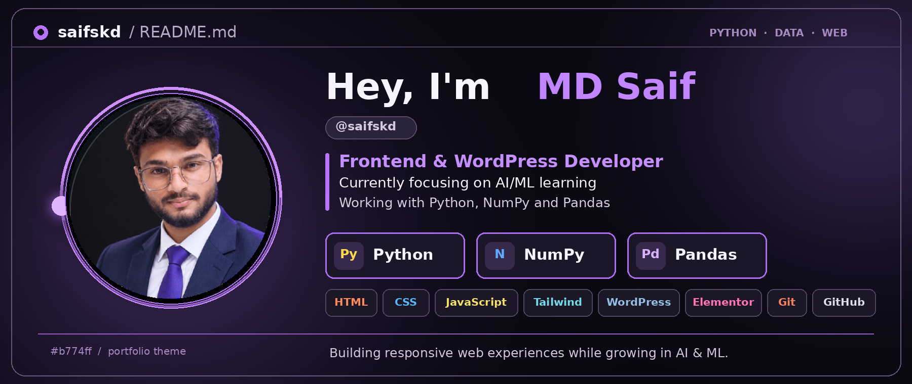
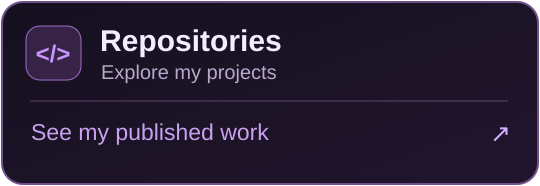
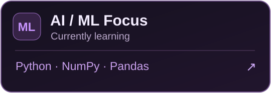

  

**Frontend & WordPress Developer · Python Learner · Exploring AI/ML**

### 👋 A little about me

I'm **MD Saif**, a **Frontend & WordPress Developer** based in Delhi NCR. I create responsive, SEO-friendly web experiences and convert designs into functional websites.

These days, my main learning focus is **Artificial Intelligence and Machine Learning**. I'm strengthening my foundations in **Python, NumPy, and Pandas**, working with datasets, and documenting what I learn.

- 🔭 **I work with:** WordPress, Elementor, JavaScript, HTML, CSS, Tailwind CSS
- 🧠 **I am learning:** Python, NumPy, Pandas, data analysis and ML foundations
- 📊 **Recent practice:** Reading CSVs, manipulating DataFrames, `head()`, `tail()`, `loc` and `iloc`
- 🎯 **Next goal:** Build and publish hands-on data-analysis and beginner ML projects
- 💬 **Ask me about:** Frontend development, WordPress, Figma-to-website workflows

### 🧠 AI & ML — My current focus

| Technology | What I am practicing |
| :-- | :-- |
| **Python** | Core programming, functions, scripting, and data workflows |
| **NumPy** | Arrays, indexing, and numerical operations |
| **Pandas** | DataFrames, CSV datasets, filtering, `loc`, `iloc`, `head`, and `tail` |
| **Machine Learning** | Building the foundations before moving into ML models |

### 🛠️ Technologies I work with

**Also:** Elementor · Divi · Bricks Builder · SCSS · Responsive UI · SEO-friendly websites

### 🚀 Selected projects

These are existing web-development projects from my GitHub. I'll feature dedicated AI/ML projects here as I build them.

| Project | What it's about |
| :-- | :-- |
| [**ImgGenerator**](https://github.com/saifskd/imgGenerator) | Image search and discovery interface |
| [**QR Generator**](https://github.com/saifskd/qr-generator) | QR code generation utility |
| [**Clove Dental**](https://github.com/saifskd/clove-dental) | Frontend website project |
| [**Tristar Aviation**](https://github.com/saifskd/tristar-aviation) | Aviation-themed website project |
| [**Weather**](https://github.com/saifskd/weather) | Weather-based web project |

### 📊 GitHub activity

  
  
  

> The cards above open **live GitHub pages**. Your actual contribution calendar is also displayed automatically by GitHub on your profile, beneath your README and pinned repositories. No placeholder contribution numbers are used.

<strong>💜 My learning roadmap</strong>

- [x] Begin Python programming
- [x] Practice tabular data with Pandas
- [ ] Complete more NumPy and Pandas exercises
- [ ] Build a dedicated data cleaning / exploratory analysis project
- [ ] Learn introductory machine learning models and evaluation
- [ ] Share an end-to-end beginner ML project on GitHub

### 🤝 Let's connect

I'm interested in **clean websites, useful automation, Python, data, and practical AI applications**. If you're learning similar things, feel free to connect.

[**Portfolio**](https://saifskd.netlify.app/) &nbsp; · &nbsp; [**LinkedIn**](https://linkedin.com/in/saifskd) &nbsp; · &nbsp; [**GitHub**](https://github.com/saifskd) &nbsp; · &nbsp; [**Email**](mailto:saifskd3@gmail.com)

Built with curiosity, consistency, and a lot of learning. 💜

